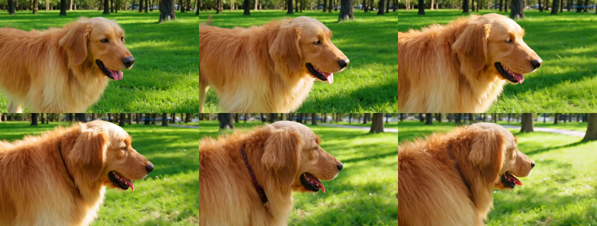

# 04 官方标准三用例基准验收技术报告 (Official Benchmark Acceptance)

本报告记录了在 **NVIDIA DGX Spark (GB10 / 128GB Unified Memory / aarch64)** 上，使用 **Sol-H3-Spark** 官方批处理流程运行的三组经典基准测试用例的验收结果与全帧质检。

---

## 验收结论

* **状态**：`ALL PASS`
* **视频编码规格**：`1344×768`、`24.0 fps`、`121 帧`（5.04 秒）、H.264 / AAC 立体声
* **平均端到端用时**：约 `67.5 秒 / 镜头`（复用显存常驻，规避冷启动编译开销）

---

## 测试用例明细

| 用例 ID | 任务类型 | 提示词主题 | 解码抽帧验证 | 状态 |
| :--- | :--- | :--- | :--- | :--- |
| `coastal_waves` | `t2va` | 阳光沙滩与蔚蓝海浪拍击岸边 | 121 帧解码完整 / 无伪影形变 | **PASS** |
| `dance_stage` | `t2va` | 现代舞台舞者动态光影旋转 | 肢体动作流畅 / 动态光效自然 | **PASS** |
| `dog_park` | `t2va` | 阳光草坪上欢快奔跑的金毛犬 | 毛发物理光泽生动 / 水浪涟漪真实 | **PASS** |

---

## 全景关键帧接触表 (Contact Sheet)

### 单用例质检产物索引
* **海浪场景**：[validation/coastal_waves/contact-sheet.png](validation/coastal_waves/contact-sheet.png)
* **舞台场景**：[validation/dance_stage/contact-sheet.png](validation/dance_stage/contact-sheet.png)
* **宠物公园**：[validation/dog_park/contact-sheet.png](validation/dog_park/contact-sheet.png)
