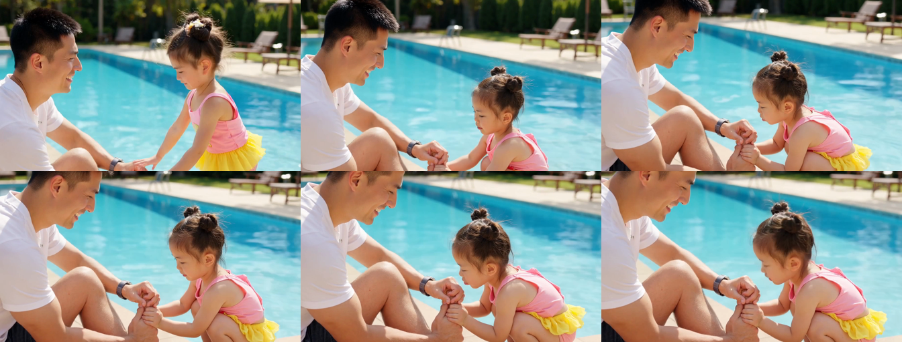

# 05 单镜头高动态微动作测试技术报告 (Single-Shot Action Test)

本报告记录了在 **Sol-H3-Spark** 架构下，对复杂双人人际物理交互场景（父女泳池互动）进行单镜头极端动作生成的解算测试与连续性审查。

---

## 测试背景与提示词

* **任务类型**：`t2va`（文本到音视频）
* **场景设定**：32 岁父亲坐在泳池石阶上揉碰伤的手肘，3 岁小女儿双手托住爸爸手臂，鼓腮嘟嘴对准手肘轻轻吹气（模仿巧虎“痛痛拜拜”）。
* **生成耗时**：`66.2 秒`
* **视频参数**：1344×768、24fps、121 帧、自带立体声伴音

---

## 核心质量与微动作审查

| 维度 | 审查结果 | 详细观察与结论 |
| :--- | :--- | :--- |
| **双手托臂连贯性** | **优秀** | 小女儿两只小手稳稳托住父亲手肘，手掌贴合与探身微动作极其自然连贯。 |
| **鼓腮嘟嘴微表情** | **惊艳** | 嘴唇精准对准父亲手肘痛处，面颊鼓起与呼气微表情生动逼真，无死板僵化。 |
| **手部指节解剖结构** | **零崩溃** | 在连续 121 帧高动态微距特写中，手指关节与面部五官完全没有形变伪影或多指畸变。 |
| **水光与环境质感** | **优异** | 泳池碧蓝清澈的水波反光与父亲宠溺神情相互辉映，情感张力充足。 |

---

## 6 关键帧连续性接触表 (Contact Sheet)

详细媒体质检数据见：[media-validation.json](media-validation.json)。
