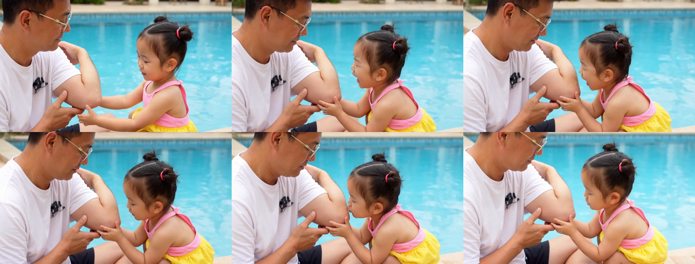
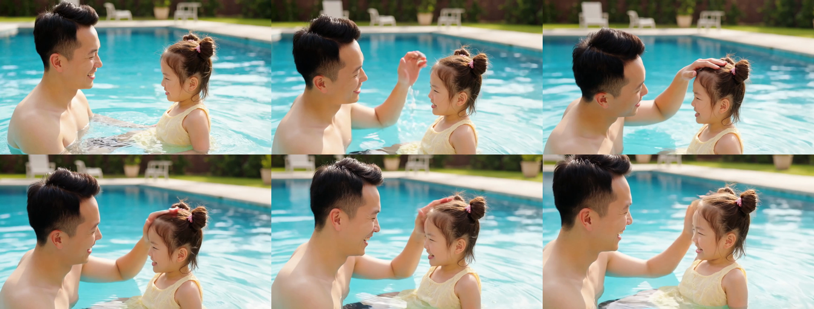

# 06 三镜头父女微短剧连续批次生成技术报告 (Multi-Shot Story Batch)

本报告记录了在 **NVIDIA DGX Spark** 上，使用 **Sol-H3-Spark** 批处理接口连续生成三镜头叙事微短剧（父女泳池碰肘与抚慰趣事）的性能指标与多镜头一致性评测。

---

## 批次执行与端到端耗时

采用官方批处理接口（`pool_elbow_story_batch.jsonl`），同一批次常驻显存，完全规避图编译与冷启动：

| 分镜编号 | 分镜内容描述 | 任务类型 | 端到端耗时 | 质检状态 |
| :--- | :--- | :--- | :--- | :--- |
| **Shot 1** | 父亲意外碰肘，轻揉手肘皱眉 | `t2va` (seed 42) | `66.64s` | **PASS** |
| **Shot 2** | 女儿学巧虎双手托臂、鼓腮吹气痛痛拜拜 | `t2va` (seed 42) | `66.08s` | **PASS** |
| **Shot 3** | 父亲破涕为笑开怀大笑，抚摸女儿丸子头 | `t2va` (seed 42) | `63.25s` | **PASS** |
| **整体批次** | **3 镜头连续成片（共 15 秒高清音视频）** | **Batch** | **平均 65.32s / 镜** | **ALL PASS** |

---

## 3 分镜关键帧接触表

### Shot 1 · 意外碰肘

### Shot 2 · 呼呼吹肘痛痛拜拜

### Shot 3 · 破涕开怀大笑

---

## 实战发现的问题与改进方向（一致性复盘）

1. **角色跨镜头漂移**：纯文本生成依靠随机潜变量，爸爸在三镜中（墨镜赤膊 → 戴眼镜白T → 摘镜入水）判若三人，女儿泳衣与面部细节脱节；后续需接入参考图先验或专用 LoRA。
2. **场景空间割裂**：岸边斜坡石阶、近景水纹与背景绿植树篱未能统一；后续需以固定全景场景底图作为空间先验。
3. **原生音频缺乏对白台词**：物理拟音强，但台词咬字无法讲清且无唇形对齐；后续建议音画解耦，外挂专业儿童 TTS 与口型同步工具。
