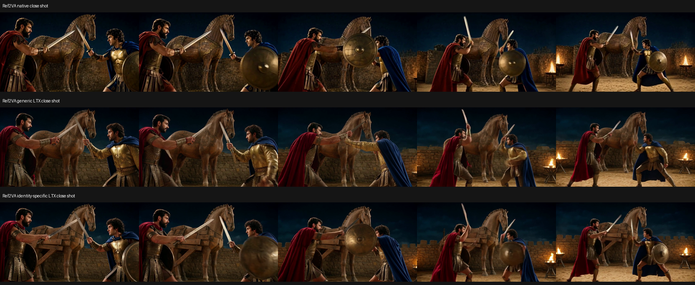
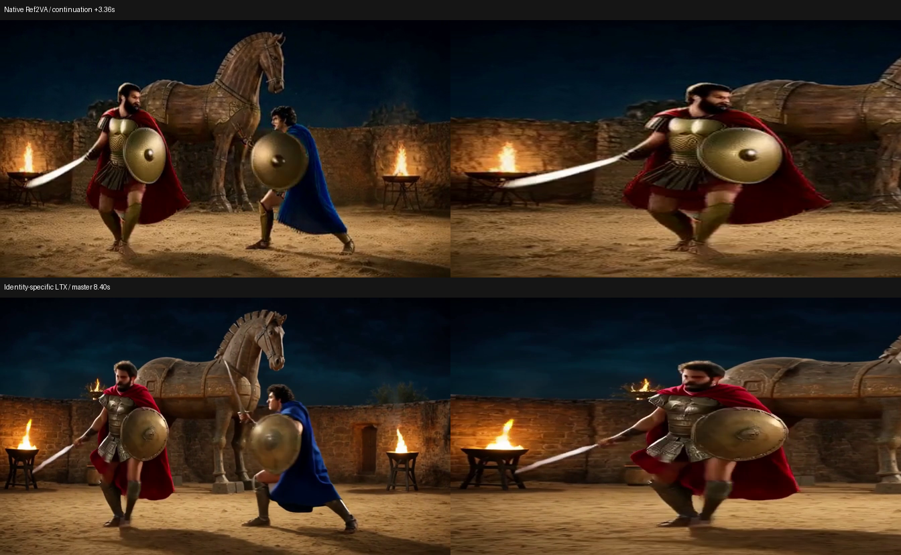

# Troy 角色一致性实测（2026-10-03～04）

本轮完成 H3 多参考图与续拍、LTX 专用提示词、降低精修噪声、Ingredients、MSR V2 五组实际推理。主要发现：当前通用 LTX 精修会把木马改成真马并移除盾牌；换成描述角色、装备和木制场景的专用上下文，在同一份 H3 潜变量上显著改善了这两项。另一方面，H3 续拍后段自身也会增加道具：约 8.4 秒时红衣角色长出第二面盾牌，原生解码和精修结果中都有，因此尚未完全解决脸、盔甲和装备一致性。

## 可以直接观看的结果

- [分镜试验版，10.083 秒](optimized_workflows/storyboard.mp4)：独立广角镜头接独立近景，1344×768、242 帧、24 FPS、32 kHz 双声道。
- [连续接拍试验版，9.292 秒](optimized_workflows/continuous.mp4)：首段 121 帧，加续段 102 帧；保留 22 帧动作上下文和 24 帧音频上下文，1344×768、24 FPS、32 kHz 双声道。
- [四方案同屏对照](four_methods_comparison.mp4)：通用 LTX、专用 LTX、Ingredients、MSR V2。音轨统一取专用 LTX 对照片；后两项是重新生成，不是同一 H3 潜变量的精修。
- [原生 H3 分镜版](ref_native/storyboard.mp4)、[原生 H3 连续版](ref_native/continuous.mp4)：672×384，供区分 Stage1 和 Stage2 的漂移。
- [Ingredients](ingredients/trial.mp4)、[MSR V2](msr/trial.mp4)：各 768×448、121 帧、24 FPS、48 kHz 双声道。

## 方法和观察

| 方法 | 实际运行方式 | 观察与边界 |
| --- | --- | --- |
| H3 Ref2VA + Motion Context | 同一套 5 张参考图，独立→续拍→独立；4 步 H3，原生 VAE 和通用 LTX 分别解码 | 角色、装备和场景参考仍参与续拍；1272 行参考条件和动作前缀均验证冻结。后段仍出现额外盾牌；冻结条件不等于语义一致性。 |
| LTX 专用提示词 | 复用原 FL2VA opening 的同一潜变量和 seed，保持原 3 步噪声表与 LoRA 强度，只替换后连接器文本特征 | 抽查帧中木制结构和蓝衣盾牌恢复；近景更符合无胡须的蓝衣角色描述。尚不能认定身份完全锁定。 |
| 低噪精修 | 同一潜变量、专用提示词，噪声表 `[0.421875, 0.3, 0.15, 0]`，仍为 3 步 | 更偏向保留来源画面，但仍改变火焰、纹理等细节。中间噪声值为实验插值，不是官方蒸馏噪声表。 |
| Ingredients 0.9 | 黑底参考拼图作为 121 帧静态视频；官方 IC-LoRA 条件；8 步原生 LTX | 两把剑、盾牌和披风颜色有保留；画面较暗，盔甲样式和脸部仍有变化。没有在本轮接入 H3 精修。 |
| MSR V2 | 4 个独立图像槽，每槽重复 33 帧，加入已学习的槽嵌入，负时间偏移 -4/-3/-2/-1，采样时前置参考 token | 武器和红蓝角色区分有效；盔甲和木马装饰出现变化。使用本机原生适配，未宣称与 ComfyUI 输出数值一致；本轮未用音频参考，也未做第二阶段上采样。 |
| Layout-To-Render | 未运行 | 官方 ModelScope 仓库只有 README，无权重；官方 HF 文件返回 401。没有把其他 LoRA 冒充为该方法。 |

专用提示词还用于重新精修已完成的三份 Ref2VA 捕获，输出上面的两部完整视频。当前最好把它看作能减少场景/装备被精修改写的方案，不能把它当作人脸识别锁。

## 素材和可比性

所有素材来自上一轮同一张 1344×768 分镜图的裁切与拼图，见 `assets/asset_manifest.json`。没有生成新的脸、多角度形象或新的武器。固定角色规则是：红衣胡须角色右手持银色直剑、左手空；蓝衣卷发角色右手持剑、左手持一面圆盾。原分镜里红衣角色没有盾牌，本轮修正了上一轮文本中双方都有盾的冲突。

脸部原始裁切只有约 105×116 和 101×95 像素，且主要是侧面，没有正面和转身参考。不同视角的鼻形、胡须、盔甲纹样不能仅凭这些素材保证一致。此处是一个虚构 Troy 对打案例的人工视觉筛查，没有用像素误差冒充人脸身份评分，也没有做多 seed 统计。

H3 与 LTX 独立生成并非严格单变量对照。**同潜变量的通用/专用/低噪 LTX 精修**才是用于定位精修影响的受控部分。各方法推理时间包括不同的模型加载、图像编码与校验边界，不能直接当作吞吐比较。

## 下载、版本和验证

优先使用 ModelScope，下载后整文件 SHA-256 与官方 HF 固定版本的元数据一致：

| 权重 | 文件字节数 | SHA-256 |
| --- | ---: | --- |
| Ingredients 0.9 | 1,308,787,472 | `ff873a5beada3c579a8137c7c53343916f78bcc9a529ba910143073fe8715e95` |
| MSR V2 | 2,215,094,328 | `7cf982168d4f77f44b02943fb458f937f90c89335dcf7cf71b2f425e78bab713` |

- H3 多参考续拍的 6 项真实 packing ABI/冻结条件检查通过，包括原生图像、视频、音频参考位置和值保留，以及检测被修改的参考行。原有 65 项回归测试通过。
- MSR 负时间位置、干净参考 token、前置/恢复/裁剪检查通过；实际 GPU 推理也通过。第一次 GPU 尝试发现条件方法的关键字接口不匹配，修复后才生成这里展示的结果。
- 三个专用文本缓存均由现有原生 INT8 Gemma 和连接器离线编码；保存后与新鲜连接器输出逐 tensor 完全相等。没有恢复 Qwen 文本服务。
- 原生 H3 对照使用完整官方 VAE，严格加载已转换的分片权重；输入是与 LTX 交接相同的 BF16 潜变量，不是 TAEH3 预览。
- 所有展示视频均完整解码并核对帧数、尺寸、帧率和双声道，记录在 `media_validation.json`。这只确认文件有效，不代表视觉一致性已通过。
- 服务已恢复 `READY`，FL2VA 的 independent/continue 两种工作流可用，状态见 `status_after.json`。生产默认精修仍使用原来的通用缓存，本轮专用上下文与低噪表保留在实验脚本中，没有默认替换所有题材的配置。

## 重现代码

脚本位于 `scripts/04_test_benchmark/`：`prepare_identity_assets.py`、`download_ltx_identity_weights.py`、`run_identity_ref2va.py`、`decode_h3_identity_baseline.py`、`build_identity_prompt_caches.py`、`run_ltx_identity_trial.py`、`refine_identity_capture.py`、`refine_identity_workflows.py`、`run_identity_queue.py`、`assemble_identity_comparison.py`。队列按阶段保存结果，复用已经完成的捕获与缓存，并使用推理锁避免并行占用 GPU。

运行时参考续拍实现位于 `scripts/01_env_setup/sol_spark_runtime/workflow_overlay/runtime/stage1_ops/continuation.py` 与 `runtime/workflows.py`，通过带哈希检查与备份的安装器部署。Ref2VA 与 FL2VA 使用各自的模型实例，但每个实例内都支持独立镜头与接拍。

依据：

- [H3 全参考提示词格式](https://huggingface.co/MiniMaxAI/MiniMax-H3/blob/main/docs/VIDEO_PROMPT_WRITING_GUIDE_ref_en.md)
- [Ingredients 官方 ModelScope 仓库](https://modelscope.cn/models/Lightricks/LTX-2.5-22b-IC-LoRA-Ingredients)
- [MSR V2 ModelScope 仓库](https://modelscope.cn/models/LiconStudio/LTX-2.5-Multiple-Subject-Reference)
- [Layout 官方 ModelScope 仓库](https://modelscope.cn/models/Lightricks/LTX-2.5-22b-IC-LoRA-Layout-To-Render)
- [MSR 原始实现](https://github.com/liconstudio/ComfyUI-LTX2.5-MSR/tree/03061c18f8a79d26f3c63931dd8e28f5e5d872a6)，Apache-2.0 许可证与来源记录保存在 `sources/`。
