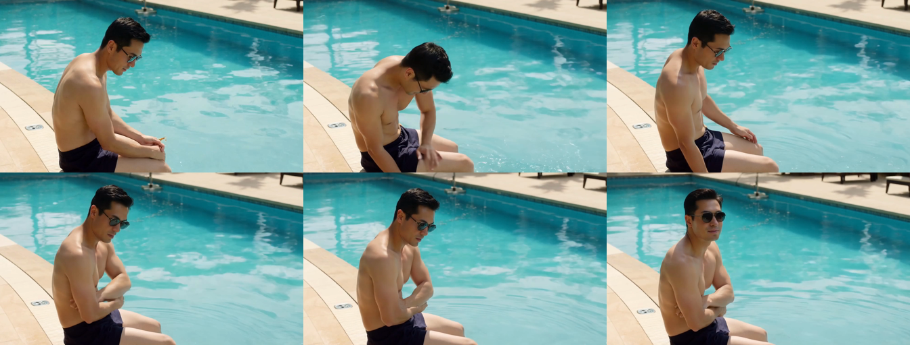

# 英伟达Sol-H3-Spark第一次微短剧实战复盘

刚部署完 Sol-H3-Spark 就拉进真实微短剧实战！单卡 GB10 统一内存批量跑通三个分镜，单镜 65 秒极速交卷。但在真实生活叙事下，四大隐藏暗坑也彻底浮出水面！


| 核心评测维度 | 实测具体表现 | 综合评级 |
| :--- | :--- | :--- |
| **实战题材** | 父女泳池微短剧碰手肘呼呼痛痛拜拜 | 原创叙事 |
| **批量成片耗时** | 三镜头连续批量生成平均仅 65 秒 | 极速 |
| **视频编码规格** | 1344×768 24fps 121 帧无损解码 | 达标 |
| **微动作表现** | 小女儿探头嘟嘴吹气解剖结构零崩溃 | 惊艳 |

> **实操战果速递**：跑官方示例只是及格线，端到端真实短剧才是照妖镜。我们不仅跑通了 65 秒批量极速成片，更在第一现场挖出了工业化落地的四大核心暗坑。

---

## 单卡六十五秒批量连续出片的高效流水线

从单次冷启动到生产级连续批次，官方架构在 128GB 统一内存下展现出了极为强悍的模型常驻复用能力。

1. 规避冷启动五分钟重复图编译开销
   同一批次复用常驻内存的 Qwen、H3 与 LTX-2.5 模型，首轮预热完成后每个分镜仅需 65 秒。
2. 三镜头分工协作承载十五秒完整微短剧
   将意外碰肘、学巧虎吹手肘和破涕温馨大笑分为三个 5 秒镜头，告别单镜头动作仓促拥挤。
3. 全自动无损解码与关键帧接触表自动抽取
   批次完成后自动执行 FFmpeg 全帧解码校验，并为每个分镜抽取 6 帧关键帧接触表自动归档。

```bash
# 启动 Sol-H3-Spark 多镜头批量生成流水线
python3 run_pool_elbow_batch.py \
  --prompts pool_elbow_story_batch.jsonl \
  --output-dir /home/admin/sol-spark-runtime/outputs/pool_elbow_story_001
# 3 个分镜连续常驻推理，单镜头端到端耗时分别仅为 66.6s、66.1s、63.3s！
```

> **避坑心得一**：微短剧生产切忌单镜头独立启停。通过官方批次接口复用预热权重与内核图缓存，能省去 80% 以上的重复加载与编译开销。

---

## 第一大致命暗坑角色与装束跨镜头严重漂移

提示词虽详尽锚定父女人设，但在无参考图驱动下，角色在跨镜头中严重漂移。

1. 爸爸造型判若三人：墨镜赤膊突然变成近视眼镜白T，第三镜摘镜入水。
2. 女儿服饰五官脱节：粉黄荷叶边泳衣突变纯黄泳装，面部五官缺乏连续性。
3. 纯文本缺乏强约束：依靠随机种子扩散，无图像嵌入引导，人物自由发散。

| 镜头编号与画面 | 爸爸角色造型表现 | 女儿角色造型表现 | 一致性评级 |
| :--- | :--- | :--- | :--- |
| **镜头 1 意外碰肘** | 佩戴黑框墨镜 赤膊深蓝泳裤 | 未出场 画面仅有父亲独坐 | 独立基准 |
| **镜头 2 呼呼吹肘** | 佩戴近视眼镜 身穿白色短袖 | 双丸子头 粉黄拼接花边泳衣 | 人设漂移 |
| **镜头 3 破涕大笑** | 摘除眼镜 头部与身躯浸在水中 | 双丸子头 纯淡黄色无袖泳装 | 服饰脱节 |

> **避坑心得二**：多镜头叙事切忌迷信纯文本提示词。必须引入源码中的图像参考接口或训练角色专属轻量 LoRA。

---

## 第二大致命暗坑场景空间割裂与机位缺乏连贯

连续播放三个片段时，观众很难建立起在同一泳池特定角落的真实空间认知。

1. 泳池环境背景脱节：岸边斜坡石阶突变特写水纹，第三镜又跳至茂密树篱。
2. 缺乏全局空间坐标：每个分镜独立生成，光照地砖与景深各自独立毫无延续。
3. 五秒固定时长硬切：受限 121 帧截断，切分处动作跳跃缺乏自然动势过渡。



> **避坑心得三**：连续分镜必须先定空间底图。固定全景场景作为环境先验，方能确保长故事在同一物理空间自然流转。

---

## 第三大致命暗坑原生音频无法开口讲清台词

MiniMax-H3 号称自带立体声音频，但在实际试听成片时，女儿的台词却成了最大的遗憾。

1. 伴音充斥着水花与杂音却说不出话
   视频虽然伴随水浪拍击声与微弱呼气声，但完全没有人类语言发音，关键台词痛痛拜拜无法清晰辨识。
2. 模型声学隐空间更偏向物理拟音
   H3 的联合音频扩散强于环境声景与物理拟音如水声、脚步、风声，并不具备普通话高清晰度语音合成能力。
3. 唇形与语音缺乏音素级对齐
   画面中小女孩的嘟嘴动作为扩散模型自主绘制，与音频时间戳没有唇形同步对齐，容易产生出戏感。

| 音频处理方式 | 适用场景与分工 | 实际听感与音质表现 | 工业可用性 |
| :--- | :--- | :--- | :--- |
| **H3 原生伴随音频** | 水浪风声物理拟音 | 环境音真实 但无法讲清对白台词 | 辅助环境音 |
| **外挂少样本 TTS** | 角色对白普通话台词 | 咬字清晰 音色生动情感充沛自然 | 生产级推荐 |
| **口型对齐微调** | 人物面部唇形同步驱动 | 唇形随发音精准开合彻底告别出戏 | 商业化必备 |

> **避坑心得四**：不要指望端到端多模态视频直接输出电影级台词。采用音画解耦策略，外挂专业儿童语音模型才是最稳妥解法。

---

## 实战神级细节大赏小女儿学巧虎呼呼吹手肘

虽然存在跨镜头一致性短板，但 Sol-H3-Spark 在单镜头的微动作解算与情感传递上展现了天花板级实力。


* **双手托臂与探头微动作**：小女儿两只小手稳稳托住父亲手肘，探身微动作极其自然连贯；
* **鼓腮嘟嘴精准吹气**：嘴唇精准对准父亲手肘痛处，脸颊鼓起与呼气微表情生动真实；
* **解剖结构零崩溃**：在连续 121 帧高动态微距特写中，手部指节与面部五官完全没有形变伪影；
* **温暖真实水光氛围**：泳池碧蓝清澈的水波反光与父亲宠溺神情相互辉映，情感张力拉满。

> **微动作心得**：在单镜头复杂人际物理交互上，Sol-H3-Spark 彻底打破了传统模型手部必崩的魔咒，展现出极强的工业级可用潜力。

---

## 下一代端侧视频生成工业化全流程演进方向

经过第一次微短剧实战的深度洗礼，我们总结出了一套端侧全流程可落地的工业化升级蓝图。

1. 升级图像参考驱动与角色轻量训练
   开启源码预留图像条件接口，辅以人物特定 LoRA 锁死面部与服装。
2. 确立音画解耦架构引入专业语音大模型
   画面与对白解耦，对白交给专业少样本语音模型，自动化电平混流。
3. 引入面部口型对齐与非线性转场剪辑
   成片后级接入口型驱动工具，配合交叉溶解转场打造无缝视听体验。

```python
# 下一代工业化端侧视频微短剧流水线架构
pipeline = StoryPipeline(
    video=SolH3SparkEngine(mode="ref2va", ref_images=anchors),
    audio=CosyVoiceEngine(voice_clone="toddler_cute_mandarin"),
    lipsync=LivePortraitMatcher(sync_audio_to_face=True),
    muxer=AudioFoleyMixer(bgm_ducking=True, pcm_balance=0.3)
)
```

> **实战结语**：技术探索的价值在于真实的泥泞中踩出通向未来的确定之路。更多端侧硬核实战，我们下期继续连夜开跑！
